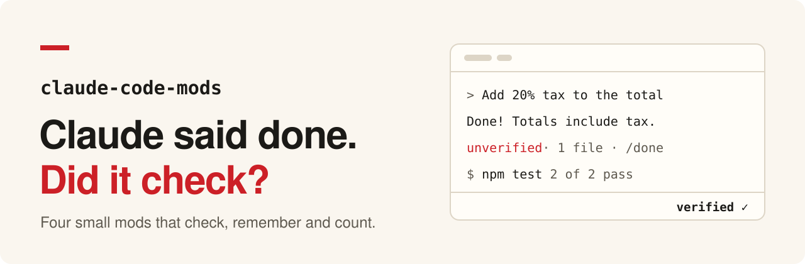
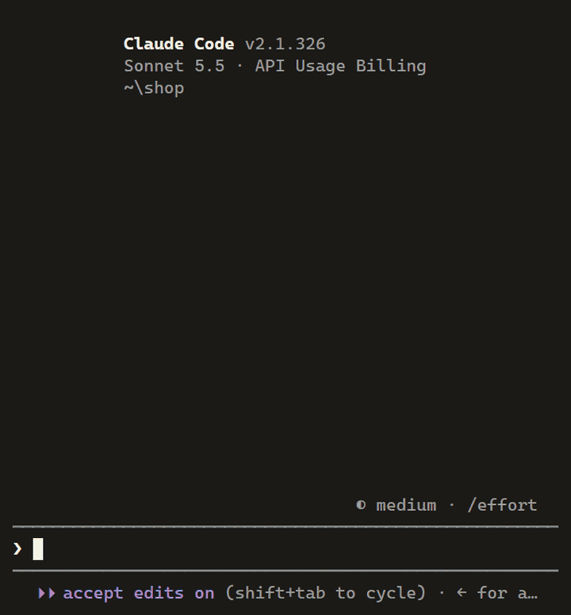
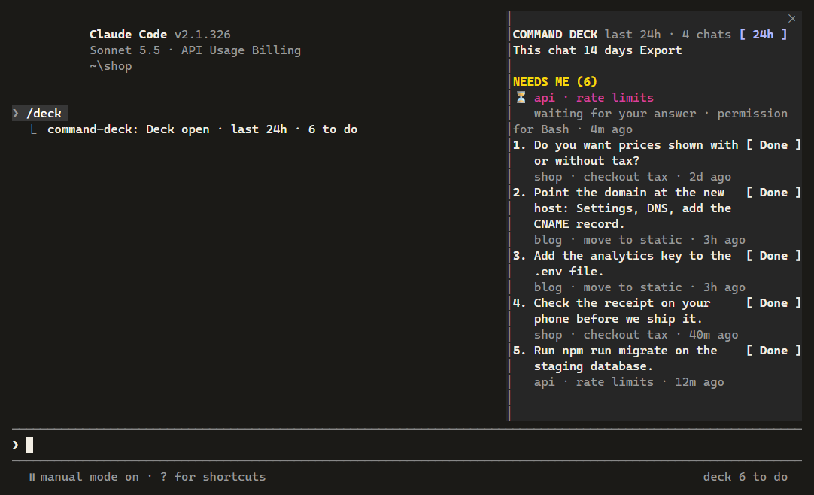

<p align="center">
  <picture>
    <source media="(prefers-color-scheme: dark)" srcset="assets/banner-dark.svg">
    
  </picture>
</p>

<p align="center"><b>When Claude says "done", know that something checked it.</b></p>

<p align="center">
  <a href="https://github.com/zed-dz/claude-code-mods/actions/workflows/ci.yml"></a>
  <a href="LICENSE"></a>
</p>

<p align="center">
  
</p>

<p align="center"><sub>A real Claude Code terminal with <b>done-check</b>, at 1.2x speed. The project and the model's replies are sample data; the product logo is left out.</sub></p>

## Who it is for

- You use Claude Code every day and have been told "done" when it was not.
- You run several chats at once and lose track of what they need from you.
- You want small mods you can read in one sitting, with nothing sent anywhere.

## Install

At the prompt of a Claude Code terminal session:

```text
/plugin marketplace add zed-dz/claude-code-mods
/plugin install done-check@zed-mods
```

Or from your shell:

```sh
claude plugin marketplace add zed-dz/claude-code-mods
claude plugin install done-check@zed-mods
```

That is all for `done-check`. Ask Claude to change some code and watch the footer. Install the others the same way, one by one.

Needs Claude Code 2.1.326 or newer. I tested 2.1.326, 2.1.327 and 2.1.332; 2.1.287 does not load them. `billing-meter` also needs Python 3.9 or newer (I run 3.14).

## What it does

| Mod | The annoyance it fixes | Command |
| --- | --- | --- |
| [**done-check**](mods/done-check) | Claude says "done" and never ran the tests | `/done` |
| [**context-keeper**](mods/context-keeper) | You clear a full chat and explain everything again | `/coach` `/backup` `/restore` |
| [**command-deck**](mods/command-deck) | Four chats open, and you forget which one waits for you | `/deck` |
| [**billing-meter**](mods/billing-meter) | You have no idea how long a client's work took | `/bill` |

**done-check** watches each turn. If code changed and no build, test or check ran after the last change, it says so and reminds Claude on your next prompt. With `/done insist on`, Claude is sent back once to run a check before it may stop.

**context-keeper** keeps a short file about each chat while you work. After `/clear`, or in a new chat in the same folder, Claude gets the latest one. It also tells you when to compact or start fresh.

**command-deck** collects what the replies ask of you, from every chat, in one pane with Done buttons:



**billing-meter** reads your local chat files and turns them into hours per project and CSV timesheets. Nothing to start or stop.

## Safety and privacy

- A mod is code that runs with your permissions. Read it first: `claude plugin validate ./mods/<name>` lists every event it hooks and every call it makes.
- No mod here opens a network connection. `billing-meter` starts Python, the others start nothing.
- `context-keeper` can ask a small model for a better summary. That is off until you set `useModel`, and it goes through your own Claude Code account.
- Files go in `~/.claude/zed-mods/<mod>/` (or under `CLAUDE_CONFIG_DIR`). Delete the folder to forget everything.
- Text that looks like a key is hidden before it is saved, but the filter has gaps. See Limits.
- `command-deck` and `context-keeper` save parts of your prompts and of Claude's replies on your disk. That is their job. `done-check` does it only with `/done log on`, and `billing-meter` only with `/bill descriptions on`. Without that, its cache holds chat file paths, times, word counts and folder names.

## Honest comparison

I checked each of these on 25 November 2026.

| If you want | Look at | Instead of mine when |
| --- | --- | --- |
| A large set of live panels and themes | [hamzafer/claude-code-mods](https://github.com/hamzafer/claude-code-mods) | You want to watch what Claude does. Mine are about what it finished and what it left to you. |
| Verification results per commit | [verify-board](https://github.com/YeonwooSung/my-claude-code-mods/tree/main/verify-board) | You want results tied to git revisions. Mine is simpler, and can send Claude back to run the check. |
| Memory across chats | Claude Code's own auto memory | You want lasting notes about a project. `context-keeper` carries over the last chat, not the lessons. |
| To continue after a usage limit | Claude Code's own setting | It is built in, so I left my mod for that out. |

## Limits

- The mods API is young and may change between Claude Code releases.
- I use these on Windows 11. The code has Linux and macOS paths and tests for them, but I have not run a session there. CI runs the test suites on all three.
- The filter hides common key shapes, not URL passwords, `curl -u`, Basic auth or plain password words; treat the saved files as private.
- done-check reads command text. A test started by an unusual script is not counted. Each mod's page says what it misses.
- In the VS Code panel the footer is not drawn, so labels show as a status line or not at all.

## Contributing

Bug reports with the exact command or reply are the most useful. See [CONTRIBUTING.md](CONTRIBUTING.md). Security reports: [SECURITY.md](SECURITY.md).

## Licence

[MIT](LICENSE), © 2026 Amine Hammou. Nothing is bundled from other projects; see [THIRD_PARTY.md](THIRD_PARTY.md).

Claude and Claude Code are trademarks of Anthropic. This is an independent project. It is not made, reviewed or endorsed by Anthropic.
