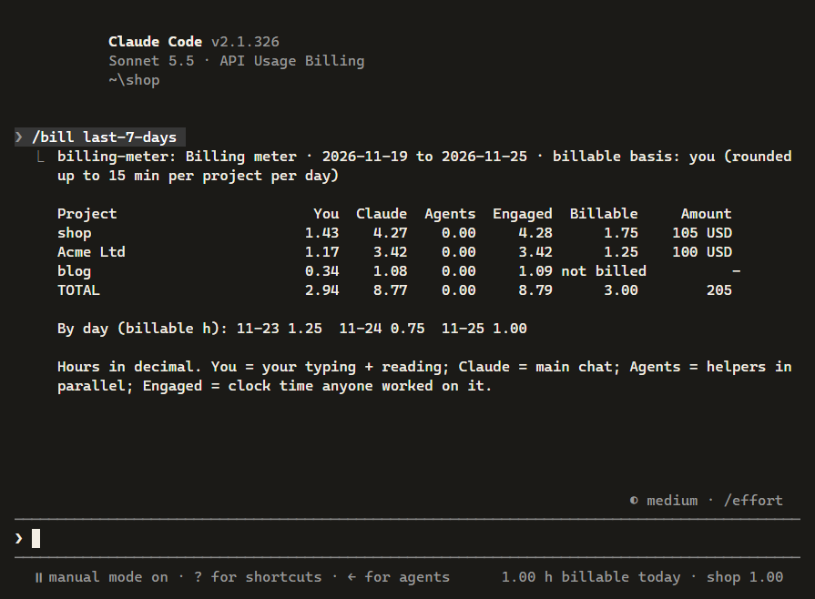

# billing-meter

How long did that client's work take? Your Claude Code chats already know.

billing-meter reads the chat files Claude Code keeps on your disk and turns them into hours per project, per day, with CSV and Markdown timesheets. Nothing to start, nothing to stop, and it works on the chats you had before installing it.



## Install

Needs Python 3.9 or newer on your PATH. No packages.

```text
/plugin marketplace add zed-dz/claude-code-mods
/plugin install billing-meter@zed-mods
```

Type `/bill`. Each chat's time goes to the folder it ran in, so there is something to see at once.

## Commands

| Command | What it does |
| --- | --- |
| `/bill` | This week |
| `/bill today`, `last-week`, `month`, `2026-10`, `2026-10-01..2026-10-15`, `last-30-days`, `all` | Any range |
| `/bill month shop` | One project |
| `/bill export last-month` | Saves CSV and Markdown timesheets |
| `/bill add "Acme Ltd" C:/code/acme` | Names a project for a folder |
| `/bill rate shop 80 USD` | An hourly rate, for the Amount column |
| `/bill project <name>` | Puts this chat's time on a project from now on (`auto` to undo) |
| `/bill basis you` | What counts as billable: `you`, `engaged`, `claude`, `you+claude` |
| `/bill descriptions on` | Adds the first words of your prompts to each timesheet line. Off by default. |
| `/bill round 15` | Rounds up per project per day; `0` for none |

## What it measures

| Column | Meaning |
| --- | --- |
| **You** | Typing each message (35 words a minute, pasted text does not count as typing) or the pause before it while you read, whichever is longer. A pause over 20 minutes counts as away. **The default basis.** |
| **Claude** | Claude working in the main chat, with no gap over 15 minutes |
| **Agents** | Helper agents, the same way. They run in parallel, so this can be more than the clock. |
| **Engaged** | Clock time when you, Claude or a helper worked on it. Overlaps count once. |

The default bills only your own time. An agent that ran all night is not your night. Choose another basis if you and your client agreed on it.

## Settings

`~/.claude/zed-mods/billing-meter/config.json`, made on the first run. A project:

```json
{ "name": "Acme Ltd", "client": "Acme Ltd", "paths": ["code/acme"], "keywords": ["\\bacme\\b"], "rate": 80, "currency": "USD", "billable": true }
```

`paths` are parts of a path, `keywords` are patterns for prompts that touched no project folder. `"weak": true` makes a project count only when nothing else was touched.

The engine also runs on its own: `python mods/billing-meter/engine/billing.py report --range month --format csv`.

## What it misses

- Only Claude Code on this computer: not claude.ai, not cloud sessions, not calls or other apps.
- Two folders with the same name count as one project until you `/bill add` them.
- Claude Code may delete old chat files (30 days by default), and their hours go with them. Export each month.
- It is an estimate from activity. Read the lines before you invoice.

## Privacy

It starts Python, outside your project and in isolated mode, and reads local files. Nothing is sent.

It keeps a cache in `~/.claude/zed-mods/billing-meter/cache.json`: for each chat file its path, the times of messages and tool calls, word counts, and project or folder names. No prompt text, unless you turn descriptions on. Then the cache and the timesheets also hold the first 12 words of each prompt, with known key formats, e-mails, links and long numbers blanked; names and other private words stay. Check the lines before a client sees them. Turning descriptions off drops the text from the cache at the next run. Timesheets you already saved stay as they are.
