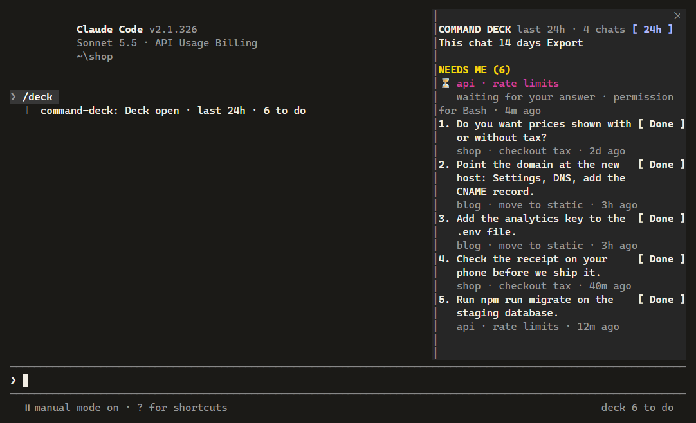

# command-deck

One list of what needs you, from every Claude Code chat on this computer.

Claude often ends a reply with things only you can do: approve this, add that key, check the page on your phone. With several chats open they get lost. command-deck collects them:

- **NEEDS ME**: steps the replies left for you, and chats that wait for your answer. Each has a Done button.
- **MY PROMPTS**: what you asked, newest first, with the chat it came from.
- **AI RESULTS**: one line per prompt about what came of it.



## Install

```text
/plugin marketplace add zed-dz/claude-code-mods
/plugin install command-deck@zed-mods
```

It starts empty and fills as you work. No model is called.

## Commands

| Command | What it does |
| --- | --- |
| `/deck` | Opens the pane. Where none can be drawn, answers with text. |
| `/deck list` | The same as text |
| `/deck here` / `all` | This chat only / the last 14 days |
| `/deck done 2`, `3 7`, `3-9` | Ticks items off |
| `/deck done group shop` | Ticks a whole group: a project, a kind (`decide`, `sign`, `run`, `test`, `read`) or an age (`older`) |
| `/deck groups` | Counts per group, and what to type |
| `/deck undo 2`, `/deck undo last` | Puts items back |
| `/deck clear-done` | Hides ticked items |
| `/deck export` | Saves everything as Markdown |

Numbers stay put: ticking item 2 leaves item 3 as 3. Ticked items stay ticked, even if Claude repeats them.

The same list is kept in `~/.claude/zed-mods/command-deck/DECK.md`, so you can open it in your editor.

## What counts as "needs me"

In Claude's final reply: the steps under a heading such as "Needs your attention", "What you do now", "Action needed" or a ⚠ line, and any line with "you need to", "you must" or "please run". Also a permission prompt or a question that is waiting.

Tell Claude to end replies with a "Needs your attention" list and it works best. One line in your CLAUDE.md does it:

```text
End each reply with a "Needs your attention" list when something is left for me to do.
```

## Settings

Each chat's folder is its project. To name your own, write `~/.claude/zed-mods/command-deck/config.json`:

```json
{
  "projects": [
    { "name": "Shop", "folders": ["code/shop"], "words": ["checkout", "invoice"] },
    { "name": "Blog", "folders": ["code/blog"], "words": ["blog"] }
  ]
}
```

`folders` are parts of a path. `words` move an item to that project when its text has them.

## What it misses

- It reads words, so a request phrased another way is missed and an odd line may slip in.
- Only chats with the mod installed are seen, on this computer.

## Privacy

Everything stays in `~/.claude/zed-mods/command-deck/`: your prompts (500 characters at most), short results and open items. Prompts go after 14 days, ticked items after 7. Common key shapes are hidden first; URL passwords, `curl -u`, Basic auth and plain password words are not. Treat the files as private. No network, no other programs.
