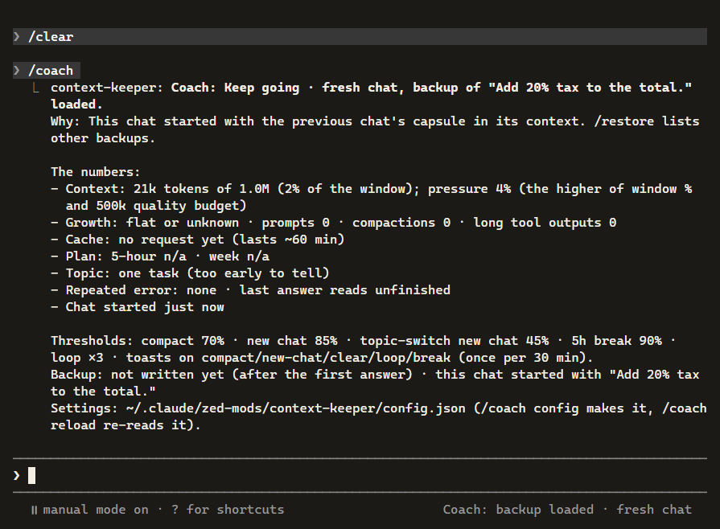

# context-keeper

Clear a full chat without losing the thread.

Two jobs:

1. **Hand-over.** While you work, it keeps a short file about the chat (a capsule): the goal, the current state, open steps, decisions, files touched, last prompts. A new chat in the same folder, or the same window after `/clear`, gets the newest one.
2. **Coach.** One line in the footer says what to do about the context: keep going, compact, clear, or start a new chat. It pops up only when the advice changes, at most once in 30 minutes for each kind.



## Install

```text
/plugin marketplace add zed-dz/claude-code-mods
/plugin install context-keeper@zed-mods
```

## Commands

| Command | What it does |
| --- | --- |
| `/coach` | The advice, why, and every number behind it |
| `/backup` | Writes this chat's capsule now and says where |
| `/restore` | Lists recent capsules from all projects |
| `/restore 2` | Loads capsule 2 into this chat |
| `/coach config` / `reload` | Makes the settings file; reads it again |

If another plugin has one of these names, use `/cx-coach`, `/cx-backup`, `/cx-restore`.

## When it says what

"Pressure" is the larger of two numbers: how full the context window is, and how much of a 500k-token budget is used. The budget is there because a 1M window gets slow long before it is full. It is my judgement; change `qualityBudgetTokens` if yours differs.

| Advice | Default |
| --- | --- |
| Take a break | the 5-hour plan window is at 90% |
| Stuck in a loop | the same error 3 times in the last 25 tool calls |
| Start a new chat | pressure 85%, or the topic changed and pressure 45%, or compacted twice and pressure 60% |
| Clear | the task reads as finished and the new request is about something else |
| Compact | pressure 70%, or 55% and rising fast |

## What a new chat receives

On a fresh chat (not a resumed one): the capsule of the chat you just cleared, else the newest from the same folder in the last 72 hours. It is added once to the system prompt, 10,000 characters at most (about 2,500 tokens), marked as background. It never changes during the chat, so the prompt cache stays warm.

## Settings

`~/.claude/zed-mods/context-keeper/config.json` (make it with `/coach config`). The ones you may want:

| Key | Default | Meaning |
| --- | --- | --- |
| `autoLoad` | `true` | Give new chats the last capsule |
| `autoLoadMaxAgeHours` | `72` | How old it may be |
| `useModel` | `false` | Let a small model write better summaries. This uses your plan or API key: one short request every `capsuleEveryTurns` prompts, at 60% and 80% pressure, before a compaction, and on `/backup`. |
| `summaryModel` | `"haiku"` | Which model |
| `compactPct`, `newChatPct` | `70`, `85` | The two main lines |
| `cacheTtlMin` | `60` | How long your prompt cache lasts. Set `5` if you pay by API key with the default cache. |
| `topics` | `{}` | `{ "Shop": ["checkout", "invoice"] }`: names for topics, so a switch is noticed by words |
| `copyTo` | `""` | A folder that also gets a copy of each capsule |

## What it misses

- Without `useModel` the capsule is an extract: your prompts, the end of the last answer, files and commands. Useful, not clever.
- The topic check is cautious. It compares folders and words, and misses a switch inside one folder.
- Where an organization manages Claude Code, some events do not reach your own mods and the hand-over may not happen.

## Privacy

No network of its own. Capsules are plain Markdown on your disk, in `~/.claude/zed-mods/context-keeper/capsules/`. Common key shapes are hidden first; URL passwords, `curl -u`, Basic auth and plain password words are not. Treat the files as private.
